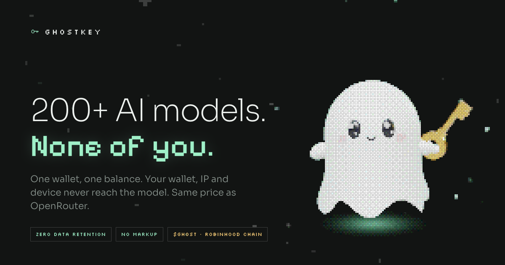

# GHOSTKEY

200+ AI models. None of you.



GHOSTKEY is a private gateway to 200+ AI chat models on OpenRouter (every model that has a zero-retention provider). You get one wallet, one balance and one API key.

- **Private.** Before your question leaves our server, we remove your wallet, IP and device. We only send it to providers that keep nothing after answering.
- **Fair.** You pay what OpenRouter charges for each call. No markup, no top-up fee.
- **Shared.** 25% of every $GHOST trading fee comes back to holders as AI credit ("Ghost Credit"), every hour. The other 75% goes to the team.

Every claim below comes with a way to check it yourself. The live version of this list is the [/proof](https://ghostkeyai.com/proof) page. It works without JavaScript.

---

## Check each claim

### 1. Same price as OpenRouter, no markup

Each call is billed at the `usage.cost` that OpenRouter returns for that call. The model list shows OpenRouter's own rates.

```bash
node tools/verify/compare-prices.mjs https://ghostkeyai.com
```

This fetches `/api/models` and OpenRouter's public `https://openrouter.ai/api/v1/models`, and compares every input and output rate. It also checks that each model is on OpenRouter's public Zero Data Retention list.

Every answer ends with a receipt (`event: receipt` in the web chat, `ghostkey_receipt` in the API). It shows tokens in and out, the rates, the cost, and the redacted request we forwarded. `usage.cost` from OpenRouter is passed through in the API response, so you can compare it with what you were charged.

Code: [`server/openrouter.mjs`](server/openrouter.mjs) (`billedCost`).

### 2. No top-up fee

```bash
curl https://ghostkeyai.com/api/deposit/quote?usd=20
```

The quote returns `feeBps: 0` and `creditUsd` equal to what you pay. Top-ups are USDG or ETH on Robinhood Chain (chain id 4663), sent to the treasury address listed on /proof. ETH is valued in USD at confirmation time.

Code: [`server/billing.mjs`](server/billing.mjs) (`quoteCredit`, `creditDeposit`).

### 3. Only zero-retention providers

Zero Data Retention (ZDR) means the provider keeps nothing after answering. OpenRouter publishes the list of ZDR endpoints at <https://openrouter.ai/api/v1/endpoints/zdr>.

- Our catalog only lists models that have at least one ZDR endpoint. Each model in `/api/models` carries `zdr: true` and `zdrProviders`.
- Every request forces `provider: { "zdr": true, "data_collection": "deny" }`. A client cannot override it.

Code: [`server/privacy.mjs`](server/privacy.mjs) (`buildUpstream`, `FORCED_PROVIDER`).

### 4. Your wallet, IP and device never reach the model

The request to OpenRouter is built in one function, `buildUpstream()` in [`server/privacy.mjs`](server/privacy.mjs). The web chat, the API and the inspector all use it.

- It uses GHOSTKEY's shared OpenRouter key and fixed headers. No client header is copied.
- Only these client fields pass: `model`, `messages` (role and content only), `stream`, `max_tokens`, `temperature`, `top_p`, `stop`, `tools`, `tool_choice`, `response_format`, `seed`, `presence_penalty`, `frequency_penalty`.
- `user`, `metadata`, `provider` and anything else are dropped.

See it with your own request. This calls no model and costs nothing:

```bash
curl -s https://ghostkeyai.com/api/inspect \
  -H 'Content-Type: application/json' \
  -d '{"model":"openai/gpt-oss-120b","user":"me@example.com","provider":{"zdr":false},
       "messages":[{"role":"user","content":"hello"}]}'
```

The answer shows `wouldSend` (the exact URL, headers and body, with our key hidden), `droppedFields`, and `notSent` (your incoming headers, none of which are forwarded).

### 5. We do not store your prompts or answers

The database keeps the model name, token counts, cost, time and OpenRouter generation ID of each call (the ID lets anyone check the billed cost at `/api/receipt/<id>`). There is no column for text. The full schema is in [`server/db.mjs`](server/db.mjs), and /proof lists every table and column, read live from the database.

Signed in, you can download everything stored about your account:

```
GET /api/me/export        (add ?download=1 for a file)
```

It returns your account row, API key prefixes, usage rows, deposits and Ghost Credit rows, plus the schema. IP addresses are not stored either: the free-message limit per IP uses a salted hash kept only in memory, and daily counters are deleted after two days.

The test suite checks this: it sends a unique marker string in prompts, then searches the raw database files (including the write-ahead log) and the export for it.

### 6. Ghost Credit: 25% of fees, every hour, recomputable

How one hour works (code: [`server/credit.mjs`](server/credit.mjs), [`server/harvester.mjs`](server/harvester.mjs)):

1. At minute 50 the server claims the $GHOST creator fee from the Pons FeeEscrow for the fee wallet. It sends 25% to the treasury (the holder pool) and 75% to the owner wallet. Every transaction hash is recorded.
2. Hour `n` is `floor(unix_time / 3600)`. At minute 5 of the next hour, the server reads every holder's $GHOST balance at four blocks: the last block at or before :15, :30, :45 and :60.
3. Holders are every address that ever received $GHOST (Transfer events). Excluded: Pons contracts (curve, escrow, pool manager and others), `0x0`, `0x…dEaD`, the fee wallet, the treasury, the owner wallet and the team wallets. The list is published in each hour's file.
4. A wallet is eligible if its average balance is at least the minimum (`minTokens`, 100,000 $GHOST at launch). Its credit is `floor(pool × average / total of eligible averages)` in micro-USD. Rounding leftovers roll into the next hour.
5. Each credit is a Merkle leaf: `keccak256(abi.encode(address wallet, uint64 hour, uint128 creditMicro))`, with sorted-pair hashing (OpenZeppelin style).
6. The hour is saved as JSON at `/api/ledger/<hour>/raw`. The Merkle root, pool, entry count and `keccak256` of that exact file are posted to the GhostLedger contract.
7. Credits are added to each wallet's GHOSTKEY balance. A wallet that never signed in gets its balance waiting for it.

Recompute any hour yourself:

```bash
node tools/verify/recompute-hour.mjs --hour <n> --base https://ghostkeyai.com
node tools/verify/recompute-hour.mjs --hour <n> --chain     # also re-reads balances (needs an archive RPC)
```

It re-derives every average and credit, rebuilds the Merkle root, verifies every proof, compares the root, pool and entry count with `GhostLedger.hourOf(hour)`, and checks the `Posted` event's `uriHash` against the file bytes.

Check one wallet against the contract's `verify()`:

```bash
node tools/verify/check-wallet.mjs --base https://ghostkeyai.com --wallet 0xYourWallet
```

The GhostLedger contract ([`contracts/src/GhostLedger.sol`](contracts/src/GhostLedger.sol)) has no owner and no upgrade path. Only its poster address can post, once per finished hour. Its source is verified on Sourcify; the link is on /proof.

### 7. Fee split 25 / 75

Each $GHOST trade on Pons costs 3%: the 1% Pons fee plus a 2% creator tax. Pons locks the creator tax at launch. The creator fee (the 2% tax plus 0.7 points of the Pons fee) goes to the fee wallet, which splits it 25 / 75.

The fee wallet, treasury and owner wallet are listed on /proof with Blockscout links, together with each hour's claim and transfer transactions. To read a transfer yourself:

```bash
node tools/verify/harvest.mjs <txHash>
node tools/verify/fee-recipient.mjs <GHOST token address> <fee wallet>   # who receives the Pons creator fee
```

---

## Where your balance comes from

1. **Top up.** Send USDG or ETH on Robinhood Chain, from $5 to $2,000. The server checks the transfer on-chain and adds the same amount.
2. **Ghost Credit.** Hold at least 100,000 $GHOST. Every hour, 25% of $GHOST trading fees is shared by holders as AI credit, by average balance.
3. **Free.** 10 free messages on budget models, no wallet needed.

Balance is prepaid AI credit. It is spent on AI calls and cannot be withdrawn or traded.

---

## Limits

- Privacy covers who you are, not what you write. The model still reads your question to answer it.
- Zero Data Retention is the provider's policy, listed publicly by OpenRouter. OpenRouter screens for illegal content as the law requires.
- Your balance is held by GHOSTKEY's server as prepaid credit. It is not a token in your wallet.
- We keep your wallet address because top-ups and Ghost Credit need it.
- Ghost Credit is platform credit for AI, not money. It depends on how much $GHOST is traded. Nothing here promises a price or profit.

---

## API

GHOSTKEY speaks the OpenAI API. Create a key at /account after signing in with a wallet.

```bash
curl https://ghostkeyai.com/v1/chat/completions \
  -H "Authorization: Bearer gk_live_..." \
  -H "Content-Type: application/json" \
  -d '{"model":"openai/gpt-oss-120b","messages":[{"role":"user","content":"Hello"}]}'
```

- `POST /v1/chat/completions` (stream or not). Non-stream responses include `ghostkey_receipt`. Streams end with a chunk that has `choices: []` and `ghostkey_receipt`, then `data: [DONE]`.
- `GET /v1/models`
- New accounts get 10 free calls on budget models.

### Public endpoints

| Endpoint | What it returns |
|---|---|
| `GET /api/config` | Chain, addresses (null until live), share, minimum, links |
| `GET /api/models` | ZDR models with OpenRouter rates (USD per 1M tokens) |
| `POST /api/inspect` | The exact request we would forward (no model call) |
| `GET /api/stats` | Messages, tokens, accounts, billed USD, Ghost Credit paid, hours posted |
| `GET /api/ledger?limit=48` | Latest hours with pool, entries, root, tx hash, status |
| `GET /api/ledger/:hour` | One hour's JSON plus its on-chain status |
| `GET /api/ledger/:hour/raw` | The exact bytes whose keccak256 was posted on-chain |
| `GET /api/holder/:wallet` | A wallet's credits with Merkle proofs and tx hashes |
| `GET /api/proof` | Contract and wallet addresses with explorer links |

---

## Run it

Requires Node 22 (it uses the built-in `node:sqlite`). The only dependency is `ethers`.

```bash
npm install
cp .env.example .env      # leave OPENROUTER_API_KEY empty for mock mode
npm start                 # http://localhost:4877
npm test                  # end-to-end tests in mock mode (port 4890, temporary data folder)
```

Without `OPENROUTER_API_KEY` the server runs in mock mode: answers are labelled fake and cost is computed from the rates. `npm run wallets` creates the server wallets into `.secrets/` (mode 600); it prints addresses only.

Layout:

```
server/          HTTP server, privacy, billing, Ghost Credit engine, /proof page
server/chain/    Robinhood Chain: RPC, prices, deposits, Pons fees, token reader, GhostLedger client
contracts/       GhostLedger (Foundry)
web/             static frontend, no build step
tools/verify/    public verification scripts
data/            SQLite database and ledger/hour-<n>.json
```
